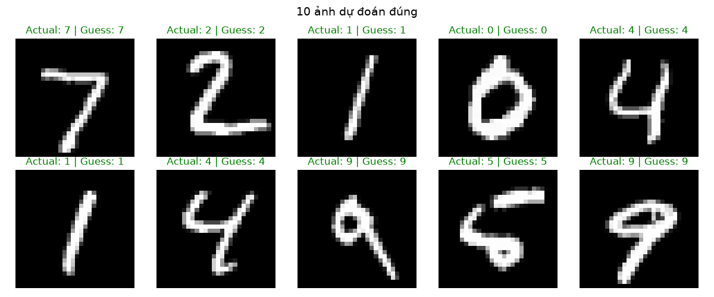
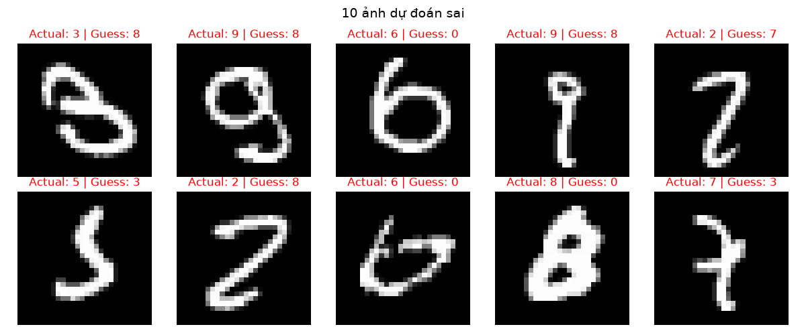

# Báo cáo thực nghiệm phân loại chữ số MNIST: CNN và Vision Transformer

## 1. Mục tiêu

Báo cáo trình bày cơ sở lý thuyết, quy trình xử lý dữ liệu và đối chiếu hai mô hình CNN và Vision Transformer (ViT) cho bài toán nhận dạng chữ số viết tay MNIST dựa trên kết quả thực nghiệm thực tế.

## 2. Cơ sở lý thuyết và lý do lựa chọn

### 2.1. Tích chập (CNN)

CNN khai thác cấu trúc không gian của ảnh bằng các bộ lọc tích chập. Với đầu vào \(X\) và bộ lọc \(W\), mỗi vị trí tạo ra \(Y_{i,j}=\sum_{u,v,c} W_{u,v,c}X_{i+u,j+v,c}+b\). Cùng một bộ lọc được dùng ở mọi vị trí, nhờ vậy số tham số thấp hơn kết nối đầy đủ trên toàn ảnh và bộ lọc có thể phát hiện cùng một nét dù nét xuất hiện ở vị trí khác. Các tầng đầu thường học đặc trưng cục bộ như cạnh/nét, các tầng sau có thể kết hợp chúng thành cấu trúc phức tạp hơn.

Hàm kích hoạt ReLU: \(f(x)=\max(0,x)\) giúp bổ sung tính phi tuyến và giúp mạng biểu diễn các quan hệ phức tạp. Lớp Max Pooling 2×2 lấy cực đại trong mỗi vùng nhỏ, giảm độ phân giải và tăng khả năng chịu dịch chuyển nhẹ của nét. Sau các tầng trích xuất, lớp Flatten chuyển Feature Map thành vector. Lớp Dense tức Fully Connected Layer kết hợp thông tin để phân loại. Dropout ngẫu nhiên tắt một phần kích hoạt lúc huấn luyện nhằm hạn chế phụ thuộc quá mức vào một số neuron. Đầu ra Dense có 10 logit. Hàm Loss là Cross Entropy so sánh các logit với nhãn đúng và được tối ưu bằng lan truyền ngược.

Mạng CNN được hiện thực gồm hai lớp tích chập (8 kernel và 16 kernel, kernel có kích thước 3×3, stride = 1), mỗi lớp theo sau bởi ReLU và Max Pooling có kích thước 2×2 và stride = 2; tiếp đến là Dense từ 400→128, Dropout 0,3 và Dense từ 128→10. Kích thước không gian lần lượt là 28→26 sau tích chập thứ nhất, 26→13 sau pooling, 13→11 sau tích chập thứ hai và 11→5 sau pooling; do đó lớp Flatten có \(5×5×16=400\) đầu vào. Hai tầng tích chập tăng dần số kênh để biểu diễn nhiều loại đặc trưng hơn.

### 2.2. Vision Transformer (ViT)

ViT chia ảnh thành các patch không chồng lấp, ánh xạ từng patch thành vector nhúng qua lớp tuyến tính (Dense) rồi cộng với positional encoding để bổ sung thông tin vị trí của patch cho mô hình biết patch nằm ở đâu. Self-attention tính mức liên quan giữa mọi cặp token (thông qua query, key, value), nhờ đó một vùng ảnh có thể dùng thông tin từ vùng khác. Multi-head attention thực hiện nhiều phép attention song song. Feed-forward network (MLP) áp dụng biến đổi phi tuyến trên từng token. Residual connection và LayerNorm giúp ổn định việc tối ưu qua nhiều tầng. Token phân loại `[CLS]` được học cùng chuỗi và làm đại diện toàn ảnh; lớp tuyến tính chuyển vector của token này thành 10 logit.

Mạng ViT được hiện thực như sau: Ảnh 28×28 được chia thành các patch 2×2 không chồng lấp. Với kích thước ảnh 28×28 và patch size 2×2, số patch theo mỗi chiều là \(28/2 = 14\), tổng cộng có \(14 \times 14 = 196\) patch. Mỗi patch có kích thước \(2 \times 2 \times 1 = 4\) giá trị, được làm phẳng và ánh xạ qua lớp `Dense(4, embedding_dim)` với `embedding_dim = 128`. Cùng với 1 token phân loại `[CLS]`, tổng chuỗi token đầu vào Transformer encoder là \(196 + 1 = 197\) token. 

Mô hình sử dụng 4 attention heads, 4 tầng encoder, chiều ẩn MLP gấp 4 lần `embedding_dim` (512 chiều), hàm kích hoạt GELU trong MLP, và dropout 0,1. Kích thước patch 2×2 giữ được độ chi tiết nét chữ rất tốt trên ảnh MNIST kích thước nhỏ 28×28.

## 3. Dữ liệu và tiền xử lý

MNIST gồm ảnh chữ số mức xám 28×28 và nhãn nguyên từ 0 đến 9. Bộ chuẩn có 60.000 ảnh train ban đầu và 10.000 ảnh test. Ảnh được đổi từ số nguyên 0–255 sang `float32` rồi chia 255, đưa cường độ về [0, 1]. Lý do là thang pixel ổn định giúp tối ưu gradient hơn so với đầu vào trị lớn 0–255, đồng thời phép biến đổi đơn giản và giống nhau cho cả hai mô hình. Thêm chiều kênh tạo tensor `[N, 1, 28, 28]` cho CNN và tách thành các patch 196 token cho ViT.

60.000 ảnh train ban đầu được chia thành 54.000 mẫu train và 6.000 mẫu validation theo tỷ lệ 90/10. Validation được dùng chọn checkpoint cho cơ chế early stopping; tách riêng nó khỏi test giúp không dùng tập đánh giá cuối để điều chỉnh mô hình. Hai mô hình chạy tối đa 10 epoch; early stopping theo validation loss với patience 3 và `min_delta=0.001` nhằm ngừng khi không còn cải thiện đáng kể và lưu lại checkpoint tốt nhất. CNN dùng optimizer Adam, ViT dùng AdamW, cùng learning rate 0,001 và Cross Entropy Loss.

## 4. Kết quả và so sánh

Kết quả đánh giá trên 10.000 ảnh test của hai mô hình được tổng hợp dưới đây:

| Chỉ số trên tập test | CNN | ViT |
|---|---:|---:|
| Test loss | 0,0339 | 0,0637 |
| Accuracy | 0,9891 (98,91%) | 0,9810 (98,10%) |
| Precision (macro avg) | 0,9890 | 0,9807 |
| Recall (macro avg) | 0,9890 | 0,9811 |
| F1-score (macro avg) | 0,9890 | 0,9809 |
| Precision (weighted avg) | 0,9891 | 0,9811 |
| Recall (weighted avg) | 0,9891 | 0,9810 |
| F1-score (weighted avg) | 0,9891 | 0,9810 |

Accuracy đo tỷ lệ dự đoán đúng trên toàn tập. Precision phản ánh độ tin cậy của dự đoán theo lớp; recall là tỷ lệ mẫu thật của lớp được nhận diện; F1 là trung bình điều hòa giữa hai đại lượng. 

Trong lần thực nghiệm này, **CNN đạt độ chính xác cao hơn ViT** (98,91% so với 98,10%) và có Test Loss thấp hơn đáng kể (0,0339 so với 0,0637). Điều này cho thấy với kích thước ảnh nhỏ (28×28) như MNIST, các mô hình tích chập (CNN) có lợi thế tự nhiên trong việc nắm bắt các đặc trưng không gian cục bộ một cách hiệu quả và nhanh chóng hơn so với mô hình Transformer vốn đòi hỏi lượng dữ liệu lớn hơn để học tốt các mối quan hệ qua cơ chế self-attention.

Xét về confusion matrix:
- **CNN**: Tổng cộng có 109 mẫu phân loại sai trên 10.000 ảnh test. Lớp 9 có số lượng nhầm lẫn cao nhất (recall = 0,9693), chủ yếu nhầm với lớp 4, lớp 5 và lớp 7. Lớp 5 có 5 mẫu nhầm thành lớp 3.
- **ViT**: Tổng cộng có 190 mẫu phân loại sai. Lớp 9 có recall = 0,9713 (980/1009 mẫu đúng), nhầm lẫn rải rác với các lớp 0, 4, 5. Lớp 5 có recall = 0,9843 (878/892 mẫu đúng), nhầm thành lớp 3 và lớp 6.

## 5. Ví dụ dự đoán của CNN

Hình 1 minh họa 10 ảnh CNN dự đoán đúng. `Actual` là nhãn thật và `Guess` là nhãn dự đoán.

Hình 2 minh họa 10 ảnh CNN dự đoán sai. Những trường hợp này cho thấy một số chữ viết tay có hình dạng dễ gây nhầm lẫn giữa các lớp.

## 6. Nhận xét

CNN tận dụng đặc trưng cục bộ và tính bất biến tịnh tiến của phép tích chập, phù hợp với cấu trúc ảnh chữ số MNIST và đạt kết quả vượt trội hơn trong thử nghiệm này (accuracy 98,91%, test loss 0,0339). Vision Transformer (ViT) với các patch 2×2 cũng đạt hiệu suất rất cao (accuracy 98,10%), minh họa khả năng ứng dụng thành công cơ chế self-attention vào dữ liệu hình ảnh. Tuy nhiên, ViT có xu hướng tốn chi phí tính toán hơn và cần nhiều dữ liệu hoặc tinh chỉnh kỹ hơn để khai thác hết tiềm năng trên các bài toán ảnh kích thước nhỏ.